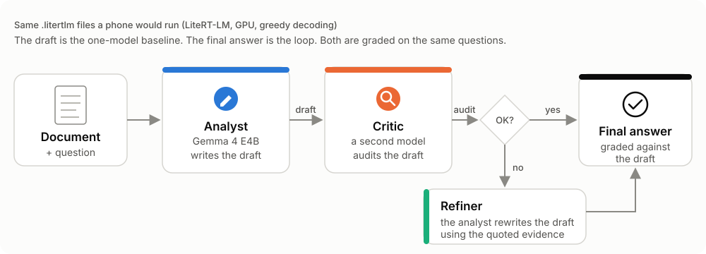
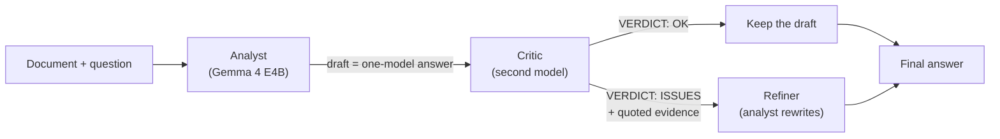
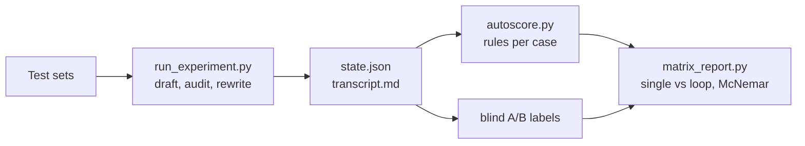
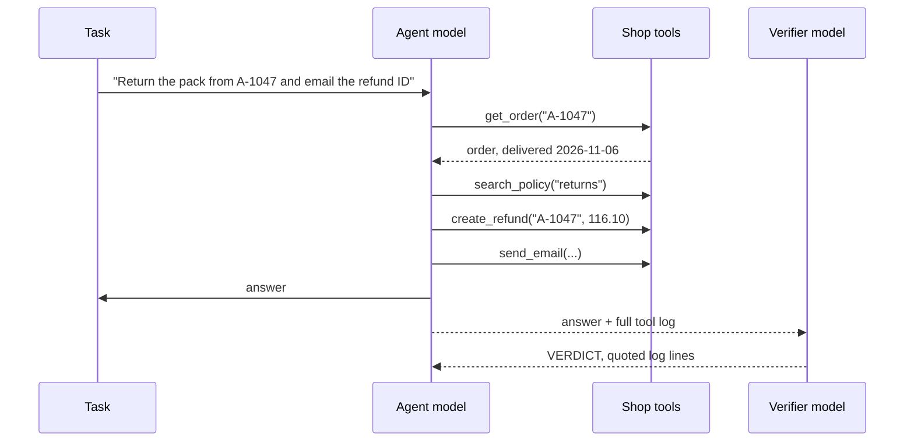
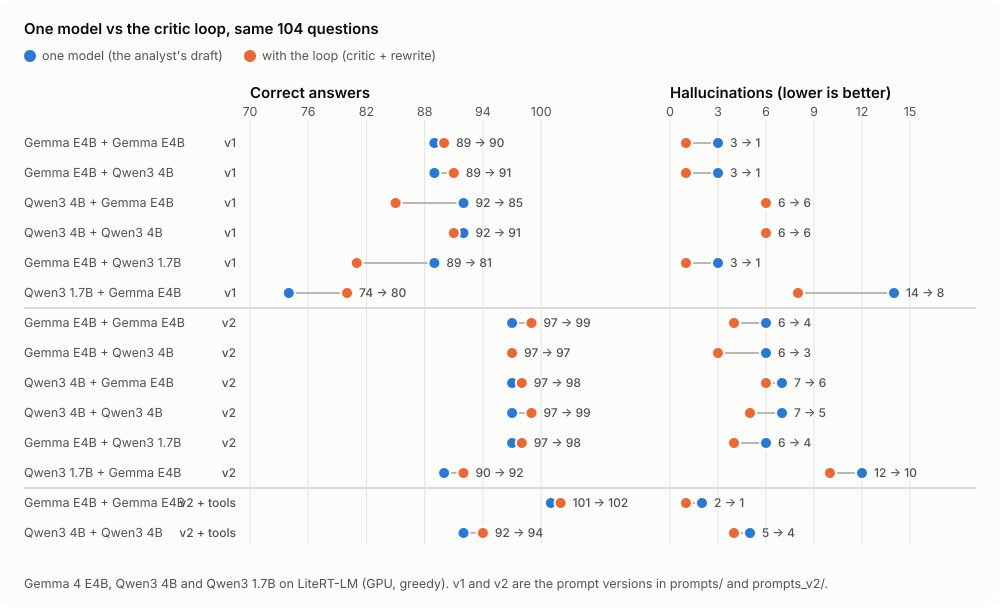
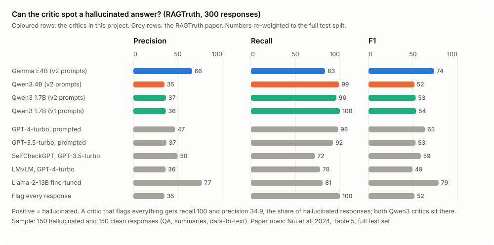
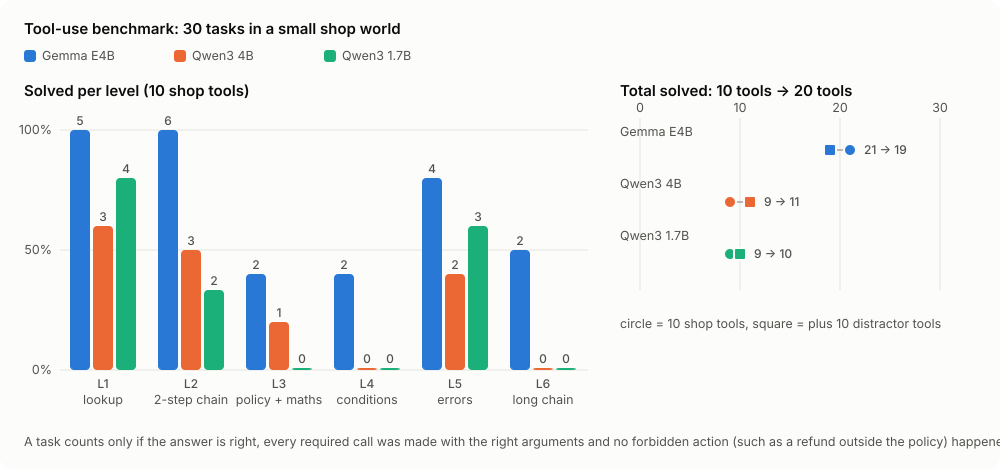
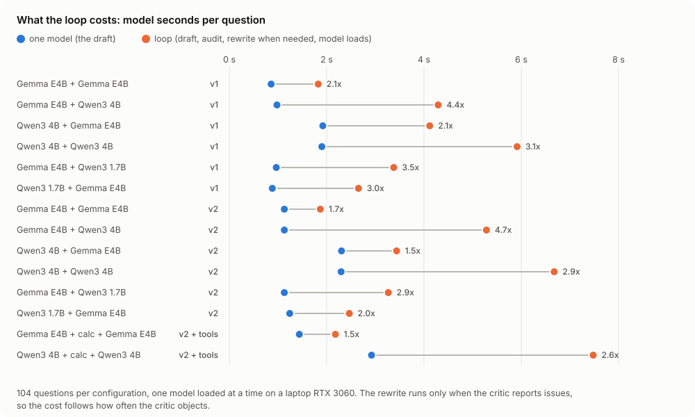

# Reflection Lab

Can two small language models that fit on a phone catch each other's mistakes? This repository tests
that on a laptop GPU, with the same `.litertlm` model files an Android phone runs through
[LiteRT-LM](https://ai.google.dev/edge/litert-lm). One model answers a question from a document. A
second model checks the answer against the document. The first model then rewrites its answer, but
only if the check found a problem.



## Goal

Small on-device models hallucinate: they state things the source document does not say, or get a
number wrong. The cheapest fix on a phone is a second small model acting as a critic. This project
measures whether that loop gives more correct answers than the first model alone, what it costs in
time, and how often it turns a correct answer into a wrong one.

Everything is measured on the same questions twice. The analyst's draft is the one-model baseline and
the loop's final answer is compared with it, question by question, with McNemar's exact test.

## The loop



The critic must start its reply with `VERDICT: OK` or `VERDICT: ISSUES`, then list problems tagged
`[UNSUPPORTED]`, `[WRONG]` or `[MISSING]`. The verdict line decides whether the refiner runs. Prompts
live in [`prompts/`](prompts) (first version), [`prompts_v2/`](prompts_v2) (calculations count as
supported, every issue must quote the document, the refiner may not delete a correct calculation) and
[`prompts_v2_tools/`](prompts_v2_tools) (v2 plus a calculator and a date tool for the analyst).

## Models and hardware

| Model | File | Size | Role | GPU memory |
|---|---|---|---|---|
| Gemma 4 E4B | `gemma-4-E4B-it.litertlm` | 3.4 GB | analyst, also tried as critic | about 3.0 GB |
| Qwen3 4B | `qwen3_4b_mixed_int4.litertlm` | 2.3 GB | critic, also tried as analyst | about 4.2 GB |
| Qwen3 1.7B | `Qwen3_1.7B.litertlm` (int8) | 1.6 GB | first critic | under 3 GB |

All three come from the [litert-community](https://huggingface.co/litert-community) repositories on
Hugging Face. The Gemma file is the one the Android app loads (the `-gpu` file in the same repository
is the web build). Runs use the LiteRT-LM Python API 0.19.2 on the GPU backend with greedy decoding
(`top_k = 1`, seed 0) and thinking turned off, so a rerun gives the same text. The test machine is a
Windows 11 laptop with an RTX 3060 Laptop GPU (6 GB), a Ryzen 7 5800H and 16 GB of RAM. Two models do
not fit in 6 GB together, so the pipeline loads one model at a time ("swap" mode): all drafts, then all
audits, then all rewrites.

## Test sets

All documents are fictional, so a model cannot answer from memory. The counterfactual documents
contradict real facts on purpose (emperor penguins breeding in the Arctic, a Soviet Moon landing in
1971), and the answer has to follow the document.

| Set | Cases | What it checks |
|---|---|---|
| [`tests/cases.jsonl`](tests/cases.jsonl) | 30 | starter set: answerable, numeric, trap (answer not in the text), counterfactual, multi-hop |
| [`tests/cases_hard.jsonl`](tests/cases_hard.jsonl) | 42 | longer documents with near-miss numbers, corrected values, superseded rules, false premises ("Why did the board reject...?" when no decision was taken), half-answerable questions |
| [`tests/cases_fresh.jsonl`](tests/cases_fresh.jsonl) | 32 | hold-out set written after the hard-set results, used to judge prompt changes fairly |
| [`tests/agent_tasks.jsonl`](tests/agent_tasks.jsonl) | 30 | tool-use tasks in a small shop world (see below) |

Each set was written from known failure patterns before any model saw it, then frozen. An independent
review checked every reference answer of the hard set before its first run.

## Grading

Every answer gets one label: **c** correct, **h** hallucination (states something the document does
not support, including an invented answer to a trap), **i** incomplete (nothing false, but part of the
question unanswered) or **r** wrong refusal ("the document does not say" when it does).

The starter and hard runs were labelled blind: answers were shuffled into A and B, labelled, and only
then was the critic's audit shown. For the larger grid, [`scripts/autoscore.py`](scripts/autoscore.py)
applies per-case rules (the value the answer must contain, whether it must say "not stated", world
knowledge that marks a hallucination, and any number that appears nowhere in the document). It agreed
with all 144 manual labels on those two runs. On the grid, every answer it flagged, every answer the
loop changed and every hallucination (133 answers) was then read one by one by a separate review pass,
which corrected the rules where they were wrong; reviewed answers carry the reviewed label.



## Agent benchmark

[`lab/agent_env.py`](lab/agent_env.py) is a small, deterministic shop called Brightwater Outdoor:
four orders, three customers, five products, a policy text, shipping rates and a fixed date
(17 November 2026). It has ten tools (`get_order`, `get_customer`, `get_product`, `list_products`,
`get_shipping_rate`, `search_policy`, `calculator`, `date_add`, `create_refund`, `send_email`) and ten
plausible distractors (currency conversion, weather, stock prices and others) for the limit tests.



The 30 tasks climb in six levels: a single lookup, two-step chains, policy plus arithmetic, actions
with conditions (a refund only inside the 30-day window), errors and missing data (a flaky service, an
unknown order, a country with no shipping rate), and chains of four to six calls. A task passes only if
the answer is right, every required call was made with the right arguments, and no forbidden action
happened. [`scripts/run_agent_bench.py`](scripts/run_agent_bench.py) runs each model with ten or twenty
tools, alone or with a verifier that checks the answer against the tool log.

## Standard benchmarks

| Benchmark | What it measures here | Script |
|---|---|---|
| [Vectara HHEM leaderboard](https://github.com/vectara/hallucination-leaderboard) | hallucination rate of summaries of the leaderboard's public documents, scored by HHEM-2.1-open on the CPU | [`bench_hhem.py`](scripts/bench_hhem.py) |
| [RAGTruth](https://arxiv.org/abs/2401.00396) | how well each critic detects hallucinated responses (precision, recall, F1) | [`bench_ragtruth.py`](scripts/bench_ragtruth.py) |
| [lm-evaluation-harness](https://github.com/EleutherAI/lm-evaluation-harness) | GSM8K (chain of thought) and IFEval, 50 questions each, MMLU-Pro 28, through a LiteRT-LM model class | [`bench_lmeval.py`](scripts/bench_lmeval.py) |
| [FACTS Grounding](https://huggingface.co/datasets/google/FACTS-grounding-public) | 50 public examples that fit a 4k context, judged blind against the FACTS criteria | [`bench_facts.py`](scripts/bench_facts.py) |

## Results

Run on 17 and 18 November 2026. The full write-up with every table is
[`reports/final_report.md`](reports/final_report.md); every number comes from a folder in [`runs/`](runs).

### One model against the loop

104 grounded questions (the three sets above), each answered by the analyst alone and by the loop.



- **The analyst prompt mattered most.** Prompt v2 says that a calculation from the document counts as
  supported and asks for the result. Gemma alone went from 89 to 97 correct, Qwen3 1.7B from 74 to 90.
- **A calculator helped Gemma further:** 101 of 104 correct with 2 hallucinations, the best result.
  Qwen3 4B rarely called the tools.
- **The loop helped a little.** With v2 prompts every loop removed at least as many hallucinations as
  it added (Gemma checked by Qwen3 4B: 6 to 3) and correct answers moved by 0 to +2. On 104 questions
  none of these differences is significant. The largest reduction is Gemma checking the weaker
  Qwen3 1.7B: 14 hallucinations to 8 (p = 0.031 on its own, not significant after a Holm correction
  for the 28 comparisons in the grid). The loop lowered hallucinations in 12 of the 14 setups and
  raised them in none.
- **A mismatched critic can hurt.** With the first prompts, Gemma checked by Qwen3 1.7B lost 8 correct
  answers (89 to 81, p = 0.008): the critic called correct calculated numbers unsupported and the
  rewrite deleted them. Prompt v2, which makes the critic redo the arithmetic and quote the document,
  removed this.
- **The loop costs 1.5 to 4.7 times the model time** of one model per question, depending on how
  often the critic objects.

### Critic quality



On 300 responses from the RAGTruth test set, both Qwen3 models flag almost everything, so they cannot
tell a good answer from a bad one. Gemma 4 E4B flags about half and is right three times in four; its
estimated F1 of 74 is above the prompted GPT-4-turbo baseline in the RAGTruth paper (63). This explains
the grid: Qwen critics objected to most of Gemma's correct drafts.

### Tool-use agents



Gemma 4 E4B solved 21 of 30 tasks (19 with ten extra distractor tools), Qwen3 4B and Qwen3 1.7B 9 each.
Gemma solved every lookup and two-step chain and failed where the shop policy mattered without being
named (member discounts, free shipping, backorder dates). A verifier that only lets the agent rewrite
its answer fixed nothing. Letting the agent redo the task with its tools after an ISSUES verdict took
Gemma from 21 to 22 (Qwen3 4B as verifier) and Qwen3 4B from 9 to 13.

### Benchmark scores

| Benchmark (items) | Gemma 4 E4B | Qwen3 4B | Qwen3 1.7B |
|---|---|---|---|
| GSM8K, chain of thought (50) | 70 % | 62 % | 56 % |
| IFEval, prompt level strict (50) | 86 % | 86 % | 74 % |
| MMLU-Pro (28) | 61 % | 61 % | 43 % |
| HHEM hallucination rate, summaries (200) | 0.5 % | 3.0 % | 3.0 % |
| RAGTruth, F1 as a critic (300) | 74 | 52 | 53 |
| FACTS Grounding, judged blind (50) | 82 % (74 % with the loop) | 42 % | not run |

Small samples: the standard error is 5 to 10 points on the lm-eval tasks. Each request was one chat
message with thinking off, so these are not leaderboard numbers. On FACTS the loop broke five of
Gemma's long answers, mostly by corrupting numbers in the rewrite ("4444.7%" for 44.7 %). Gemma's
critic and first drafts do it too, and the rate rises with prompt length: 2 of 133 numbers were
corrupted below about 2,000 prompt tokens, 20 of‰9 above; Qwen3 4B corrupted none
([`facts_numbers.py`](scripts/facts_numbers.py)). Whether the GPU runtime or the model file causes it
is still open, and it is the first thing to check on the phone runtime.

### Time and compute



| | |
|---|---|
| GPU time, all 48 runs | 4.85 h on one laptop RTX 3060, 6,724 model calls |
| GPU energy | about 0.35 kWh of board power (logged every 5 s by `compute_logger.py` for the last runs, estimated before) |
| Largest experiment | the grid: 1.59 h for 14 configurations on 104 questions |
| Peak memory | 4.1 GB VRAM, 12.8 GB system RAM |

Per run, per model and for the Claude Code session that built and ran everything:
[`reports/compute.md`](reports/compute.md).

## Running it yourself

You need Python 3.11 or newer and about 6 GB of disk for the two default models. A GPU with 4 GB or
more is recommended; the CPU backend works but is slow.

```powershell
# Windows
powershell -ExecutionPolicy Bypass -File .\bootstrap.ps1
.\.venv\Scripts\Activate.ps1
```

```bash
# Linux or macOS
./bootstrap.sh
source .venv/bin/activate
```

Then, on any system:

```bash
python scripts/find_models.py                        # read-only scan for models you already have
python scripts/get_models.py --plan                  # files and sizes that would be downloaded
python scripts/get_models.py --required --yes        # Gemma 4 E4B + Qwen3 1.7B into ./models
python scripts/run_experiment.py --runtime fake --limit 3            # pipeline check, no model
python scripts/run_experiment.py --limit 2 --name smoke              # first real test
python scripts/run_experiment.py --cases tests/cases_hard.jsonl --prompts prompts_v2 --name hard
python scripts/autoscore.py --run runs/<folder> --apply              # grade it
python scripts/report.py --run runs/<folder>                         # rates, intervals, McNemar
python scripts/run_matrix.py --preset grid                           # every analyst/critic/prompt pair
python scripts/run_agent_bench.py --model gemma-4-e4b --verifier qwen3-4b --retry
python scripts/compute_logger.py                     # GPU power and load every 5 s (own window)
python scripts/compute_report.py                     # time, calls and energy per run -> reports/compute.md
```

Machine-specific settings (your model folders, a download folder outside the project, a Hugging Face
token file) go in `config.local.toml`, which git ignores. Copy
[`config.local.example.toml`](config.local.example.toml) to start. On Windows,
`.\open_window.ps1 scripts\<script>.py <args>` runs a script in its own window with a live view.
[`START_PROMPT.md`](START_PROMPT.md) is a starting prompt for doing all of this with Claude Code, and
[`CLAUDE.md`](CLAUDE.md) holds the project rules and the verified facts about the runtime.

The standard benchmarks need extra packages:
`pip install torch --index-url https://download.pytorch.org/whl/cpu` and then
`pip install -r requirements-bench.txt`.

## Repository layout

```
lab/            runtimes (LiteRT-LM Python API, CLI, fake), config, GPU monitor, shop world, benchmark helpers
scripts/        experiment, grading, reports, grid, queue, agent and standard benchmarks, public export
prompts*/       analyst, critic and refiner prompts (v1, v2, v2 with tools) and the agent verifier prompts
tests/          frozen test sets, their generators, grading rules, agent tasks, FACTS subset
runs/           every run: meta.json, state.json, transcript.md, events.jsonl, labels, reports
docs/img/       illustrations used in this README
```

## Limitations

The sets are small: 104 grounded questions, 30 agent tasks and 28 to 300 items per standard benchmark,
so a difference of a few answers is within chance, and the p-values are per comparison, not corrected
for multiple testing. Labels come from an AI labeller (Claude) working
blind and from grading rules written by the same author; the rules were checked against the blind
labels and an independent review, and every changed answer was read. Everything ran on one laptop GPU
with greedy decoding, so a phone may produce slightly different text. All prompts and documents are in
English.

## Licence

MIT, see [LICENSE](LICENSE). Text taken from public benchmarks (the FACTS Grounding subset in `tests/`
and the documents and responses in the `runs/bench_*` folders) keeps the licence of its source dataset.
