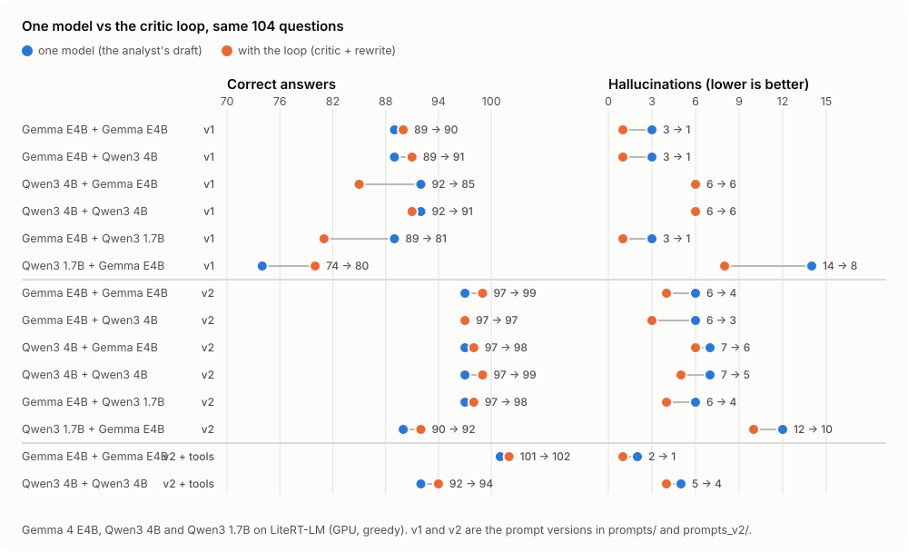
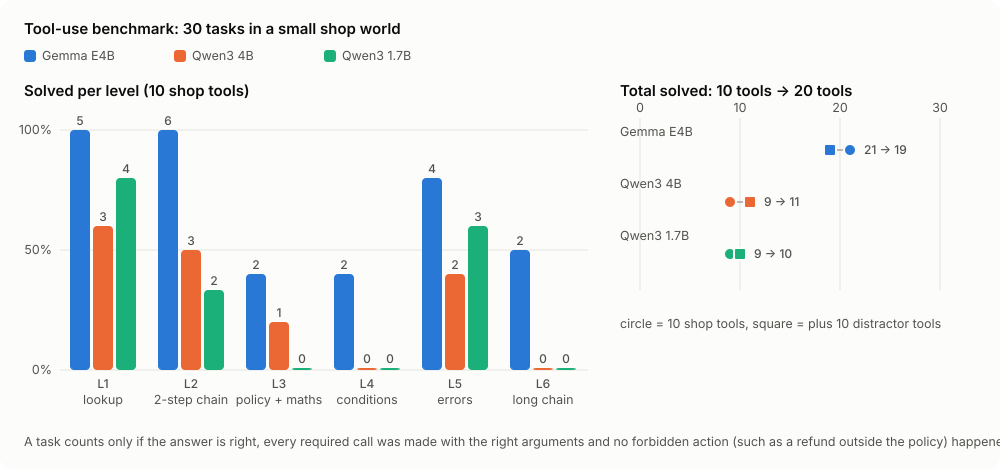
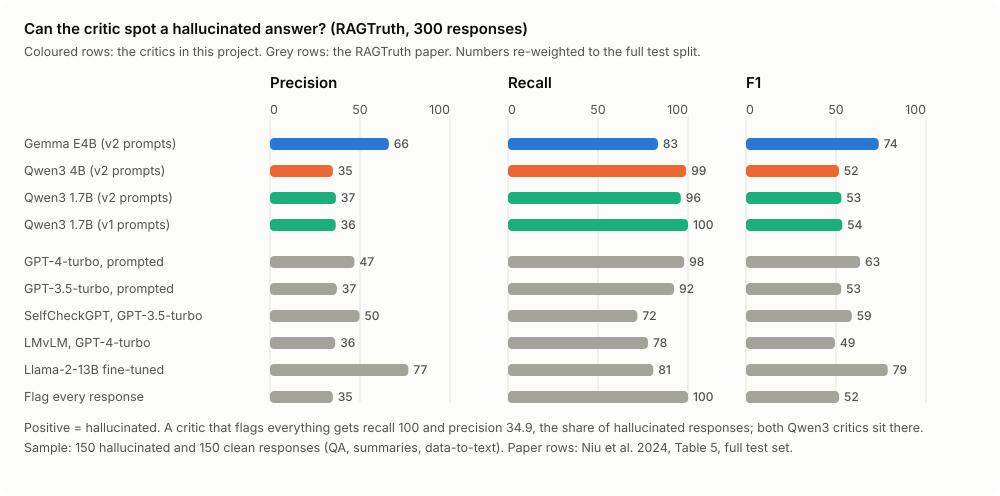

# Reflection Lab: results

Runs of 17 and 18 November 2026 on one Windows laptop (RTX 3060 Laptop GPU, 6 GB). Models: Gemma 4 E4B,
Qwen3 4B and Qwen3 1.7B as `.litertlm` files on LiteRT-LM 0.19.2, GPU backend, greedy decoding, thinking
off. Every number below comes from a run folder in `runs/`; the grid is
`runs/matrix_20261117-220336/report.md`.

## The question

Does a second small model checking the first one's answer against the source document reduce
hallucinations, compared with the first model alone? Each test question is answered twice in the same
run: the analyst's draft is the one-model baseline and the loop's final answer is compared with it,
question by question (McNemar's exact test).

## Test material and grading

- 104 grounded questions in three frozen sets: 30 starter cases, 42 hard cases (near-miss numbers,
  superseded values, false premises, half-answerable questions, counterfactual documents) and 32 fresh
  hold-out cases written after the hard-set results. All documents are fictional.
- 30 tool-use tasks in a deterministic shop world with ten tools and ten distractors.
- Labels: correct, hallucination, incomplete, wrong refusal. The starter and hard runs were labelled
  blind by Claude (A and B shuffled, critic audit hidden until the answers were labelled). The grid was
  graded by per-case rules (`scripts/autoscore.py`, version 2), and 133 answers (every flagged answer,
  every answer the loop changed, every hallucination) were then reviewed one by one by a separate review
  pass, which corrected the rules where they were wrong. The rules agree with all 144 blind manual
  labels and with 107 of the 124 reviewed corrections on their own; every reviewed answer carries its
  reviewed label.

## Results on the 104 grounded questions

| Analyst | Critic | Prompts | Correct, one model | Correct, loop | Hallucinations, one model | Hallucinations, loop |
|---|---|---|---|---|---|---|
| Gemma 4 E4B | Gemma 4 E4B | v1 | 89 | 90 | 3 | 1 |
| Gemma 4 E4B | Qwen3 4B | v1 | 89 | 91 | 3 | 1 |
| Qwen3 4B | Gemma 4 E4B | v1 | 92 | 85 | 6 | 6 |
| Qwen3 4B | Qwen3 4B | v1 | 92 | 91 | 6 | 6 |
| Gemma 4 E4B | Qwen3 1.7B | v1 | 89 | 81 | 3 | 1 |
| Qwen3 1.7B | Gemma 4 E4B | v1 | 74 | 80 | 14 | 8 |
| Gemma 4 E4B | Gemma 4 E4B | v2 | 97 | 99 | 6 | 4 |
| Gemma 4 E4B | Qwen3 4B | v2 | 97 | 97 | 6 | 3 |
| Qwen3 4B | Gemma 4 E4B | v2 | 97 | 98 | 7 | 6 |
| Qwen3 4B | Qwen3 4B | v2 | 97 | 99 | 7 | 5 |
| Gemma 4 E4B | Qwen3 1.7B | v2 | 97 | 98 | 6 | 4 |
| Qwen3 1.7B | Gemma 4 E4B | v2 | 90 | 92 | 12 | 10 |
| Gemma 4 E4B + calculator | Gemma 4 E4B | v2 + tools | **101** | **102** | **2** | **1** |
| Qwen3 4B + calculator | Qwen3 4B | v2 + tools | 92 | 94 | 5 | 4 |

### The analyst prompt matters most

With the first prompts, Gemma's misses were mostly calculations it left unfinished: it quoted "385 and
412 million" and stopped, or replied "the document does not say" when the answer took one subtraction.
Prompt v2 tells the analyst that a calculation from the document is not outside knowledge and asks it
to state the result. Gemma alone went from 89 to 97 correct, Qwen3 1.7B from 74 to 90. The cost is
visible too. Some of the new calculations come out wrong, so Gemma's hallucinations rose from 3 to 6.

### A calculator tool helps Gemma further

Giving the analyst a `calculator` and a `date_add` tool (LiteRT-LM automatic tool calling) took Gemma to
101 of 104 correct with 2 hallucinations, the best single-model result. Gemma called the tools in 18 of
the 104 drafts. Qwen3 4B called them in 2 drafts and did worse with the extra prompt line (97 to 92).

### What the critic loop adds

With v2 prompts every loop removed at least as many hallucinations as it added: Gemma checking Gemma
6 to 4, Gemma checked by Qwen3 4B 6 to 3, Qwen3 4B checking itself 7 to 5. Correct answers moved by 0
to +2. On 104 questions none of these differences is statistically significant on its own (p between
0.45 and 1.0). The one significant reduction is a strong critic checking a weak analyst: Qwen3 1.7B
checked by Gemma went from 14 hallucinations to 8 (6 removed, none added, p = 0.031).

These p-values are per comparison and not corrected for multiple testing. The grid makes 14
single-versus-loop comparisons on correct answers and 14 on hallucinations. After a Holm correction over
all 28, none of the differences is significant, including this one and the two losses below (the smallest
p, 0.008, would need to be under 0.002). The direction is the steadier result: the loop lowered the
hallucination count in 12 of the 14 setups and raised it in none, by 1 to 6 answers.

### When the loop hurts

With the first prompts, a critic that does not match the analyst made answers significantly worse.
Gemma checked by Qwen3 1.7B lost 8 correct answers and gained none (89 to 81, p = 0.008), and Qwen3 4B
checked by Gemma lost 7 (92 to 85, p = 0.016). The critic called correct calculated numbers
"unsupported", and the rewrite deleted them. Prompt v2 removed this failure: the critic must redo the
arithmetic and quote the document sentence behind every issue, and the refiner may not delete a
correct calculation. After that change no loop broke more than 4 answers, and four of the eight broke none.

## Tool-use agents

| Agent | 10 shop tools | 20 tools (10 distractors) | Average tool calls |
|---|---|---|---|
| Gemma 4 E4B | 21 / 30 | 19 / 30 | 2.4 |
| Qwen3 4B | 9 / 30 | 11 / 30 | 1.0 |
| Qwen3 1.7B | 9 / 30 | 10 / 30 | 3.5 |

Gemma solved every single lookup and every two-step chain. It failed where the task needed the shop
policy without saying so: it left out member discounts and the free-shipping threshold in four price
totals, refunded 129.00 instead of the 116.10 actually paid, and gave the restock date instead of the
backorder ship date. After one service timeout it gave up instead of retrying. Once it created a refund
the policy forbids, after claiming that 9 October to 17 November is "within the 30-day window".
Qwen3 4B usually answered after a single call, before it had the data. Qwen3 1.7B hit runtime limits on two long chains: once its
4,096-token context window was full, once a prefill size error.

A verifier that reads the full tool log and lets the agent rewrite its answer changed nothing in any of
the four pairings. Gemma as verifier approved all 30 answers, its own nine failures included. Qwen3 4B
as verifier flagged eight of Gemma's nine failures, but a rewrite cannot fetch the discount policy the
agent never looked up.

In retry mode (`--retry`) an ISSUES verdict sends the agent back to redo the task with its tools, given
the audit and a reminder to look up the shop policy; refunds and emails already sent are listed so they
are not repeated.

| Agent | Verifier | First attempt | After retry | Fixed | Broke | Retried |
|---|---|---|---|---|---|---|
| Gemma 4 E4B | Qwen3 4B | 21 / 30 | 22 / 30 | 2 | 1 | 15 |
| Qwen3 4B | Qwen3 4B | 9 / 30 | 13 / 30 | 5 | 1 | 19 |

Gemma's retry looked up the policy and fixed the gold-member price (106.65 instead of 118.50) and the
backorder ship date, and it broke a two-order total it had right before, writing 308.97 as 30.97. Most
of Qwen3 4B's first-pass failures were answers that only announced a lookup ("I need to look up the
order"); on retry it made the call and answered. Its one break is the loyalty-points question, where the
retry no longer says that the balance is unavailable. The verifier sent 15 of Gemma's 30 answers back,
seven of them correct, so a retry roughly doubles the work on half the tasks for a net gain of one.

## Standard benchmarks

These use public data sets on small samples (28 to 300 items), so they place the models against
published numbers only roughly. Scripts: `scripts/bench_lmeval.py`, `bench_ragtruth.py`,
`bench_hhem.py`, `bench_facts.py`; every run folder has a `summary.md` with the details.

### General ability (lm-evaluation-harness)

| Model | GSM8K, chain of thought (50) | IFEval, prompt level strict (50) | MMLU-Pro (28) |
|---|---|---|---|
| Gemma 4 E4B | 70.0 | 86.0 | 60.7 |
| Qwen3 4B | 62.0 | 86.0 | 60.7 |
| Qwen3 1.7B | 56.0 | 74.0 | 42.9 |

Scores in per cent; the standard error is about 7 points for GSM8K, 5 for IFEval and 9 for MMLU-Pro.
GSM8K uses the flexible answer extraction: under the strict filter, which expects the few-shot phrase
"The answer is", Gemma scores 62 and both Qwen models 6 to 8, because they state the result in their own
words. Every request was a single chat message with thinking off, so the numbers are not comparable with
leaderboard runs. Gemma and Qwen3 4B are level on instructions and knowledge; Qwen3 1.7B is behind on all
three.

### Can the critic spot a hallucinated answer? (RAGTruth)

300 responses from the RAGTruth test split (Niu et al., 2024): 150 with an annotated hallucination and
150 clean, 100 each from question answering, summaries and data-to-text. The critic audits each response
against its source with the same prompt as in the loop. "Weighted" re-weights the sample to the class mix
of the full test split, which makes it comparable with Table 5 of the paper.

| Critic | Prompts | Flagged | Recall | Precision, weighted | F1, weighted | Accuracy |
|---|---|---|---|---|---|---|
| Qwen3 1.7B | v1 | 292 / 300 | 100.0 | 36.5 | 53.5 | 52.7 |
| Qwen3 1.7B | v2 | 279 / 300 | 96.0 | 36.6 | 53.0 | 53.0 |
| Qwen3 4B | v2 | 296 / 300 | 99.0 | 34.9 | 51.6 | 49.3 |
| **Gemma 4 E4B** | v2 | 161 / 300 | 83.3 | **66.0** | **73.7** | **77.0** |
| GPT-4-turbo, prompted (paper) | | | 97.9 | 46.9 | 63.4 | |
| Llama-2-13B fine-tuned for detection (paper) | | | 80.7 | 76.9 | 78.7 | |

Both Qwen3 critics flag almost every response. Their recall is near 100 and their precision equals the
share of hallucinated responses, so they do not separate good answers from bad ones; their accuracy is at
chance. Gemma flags about half and is right three times in four. Its estimated F1 of 74 is above the
prompted GPT-4-turbo baseline in the paper and below the paper's fine-tuned 13B detector. This matches the
grid: Qwen critics objected to most of Gemma's correct drafts, Gemma as critic to very few.

### Summaries of short documents (HHEM)

200 documents sampled from Vectara's hallucination leaderboard data set, summarised by each model and
scored with the open HHEM-2.1 model (hallucinated if the score is below 0.5).

| Model | Hallucination rate | Mean HHEM score | Answer rate | Average length |
|---|---|---|---|---|
| Gemma 4 E4B | 0.5 % (1 of 200) | 0.905 | 100 % | 75 words |
| Gemma 4 E4B, Gemma critic loop | 0.5 % (1 of 200) | 0.905 | 100 % | 75 words |
| Qwen3 4B | 3.0 % (6 of 200) | 0.872 | 100 % | 83 words |
| Qwen3 1.7B | 3.0 % (6 of 200) | 0.875 | 100 % | 69 words |

All three summarise these documents faithfully by this measure. Gemma starts with one failure in 200, so
the loop had nothing to fix: the critic flagged 8 summaries, the rewrites changed a few words each, and
no score crossed the threshold. The public leaderboard uses HHEM-2.3 on a private data set, so these rates
are comparable with each other only.

### Long answers grounded in a document (FACTS Grounding)

50 examples from the public FACTS Grounding set (Jacovi et al., 2024) whose document fits a 4,096-token
context: a system instruction, a request and a document of 300 to 3,000 words, answered in up to 512
tokens. The 114 distinct responses were judged blind by three Claude subagents against the FACTS
criteria, each text once, with model and variant hidden (`scripts/facts_blind.py`). A response scores 1
only if it addresses the request (eligible) and every claim in it is supported by the document
(grounded).

| Model | Eligible | Grounded | FACTS score |
|---|---|---|---|
| Gemma 4 E4B | 94 % | 88 % | **82 %** |
| Gemma 4 E4B, Gemma critic loop | 92 % | 80 % | 74 % |
| Qwen3 4B | 94 % | 48 % | 42 % |

Qwen3 4B adds what the document does not say: general knowledge about the topic, causes and motives,
and hedged statements turned into facts ("some courts have concluded" written as settled law). Gemma
stays with the document.

The loop made Gemma's long answers worse. The critic flagged 16 of 50 answers, and the rewrites fixed 1
and broke 5 (p = 0.22). Most of the breaks are corrupted numbers, with digits doubled or dropped: "grew
4444.7%" for 44.7 %, "$23333.6 billion" for $233.6 billion, "about 10 0 million" for 100 million. Seven
of the 16 rewrites contain such a number, against 2 of the 50 first drafts; Qwen3 4B produced none, and
Gemma's HHEM summaries show 1 in 200. The judges were strict about numbers: counting the two answers
whose only fault is a digit slip as correct raises both Gemma scores by 2 points and changes no ranking.

The corruption also appears outside the rewrite. `scripts/facts_numbers.py` lists every number in an
output that appears in none of the texts that call was given (`reports/facts_numbers.md`). Gemma's critic
misquotes numbers as well ("£149.9.95" for £149.95, "P < 0.00001" for P < 0.001), and so do the first
drafts ("since May 20202"). The rate rises with prompt length: below 8,000 characters (about 2,000
tokens) 2 of the 129 numbers Gemma wrote were corrupted, above it 17 of 112. Qwen3 4B wrote 105 numbers
from the same documents and corrupted none. The rewrite gets the longest prompts (document, draft and
audit, median 11,250 characters) and copies the most numbers, so it suffers most; with 16 rewrites the
data cannot tell whether rewriting adds anything beyond the length. The count misses dropped digits that
split a number ("10 0 million"), so these figures are lower bounds. Whether the GPU runtime or the model
file causes it is still open, and rerunning the corrupted calls on the CPU backend would tell. A
corrupted number reads as a hallucination, so this is the first thing to check on the phone.

## Time and compute

Every run used the laptop's RTX 3060 with one model loaded at a time. `scripts/compute_report.py` adds up
the run folders, and the full tables (per run, per experiment, per model, and the Claude Code session that
built and ran everything) are in `reports/compute.md`. GPU board power has been logged every 5 seconds
(`scripts/compute_logger.py`) since the standard benchmarks started; earlier runs are estimated from the
measured mean power.

| | |
|---|---|
| Runs with real models | 48, from 17 November 20:56 to 18 November 02:48 |
| GPU time | 4.85 h, of which 4.25 h inside 6,724 model calls |
| Text generated | about 2.4 million characters (roughly 0.6 million tokens) |
| GPU energy | about 0.35 kWh of GPU board power (0.05 kWh measured, the rest estimated at 72 W) |
| Peak memory in a run | 4.1 GB VRAM, 12.8 GB system RAM |

| Experiment | Runs | GPU time | Model calls |
|---|---|---|---|
| Development (smoke tests, pilots, checks) | 7 | 8 min | 314 |
| Grid, 14 configurations on 104 questions | 14 | 1.59 h | 3,492 |
| Agent benchmark | 12 | 34 min | 360 |
| lm-evaluation-harness | 6 | 40 min | 384 |
| RAGTruth | 4 | 1.13 h | 1,200 |
| HHEM | 3 | 31 min | 808 |
| FACTS Grounding | 2 | 15 min | 166 |

The explainer video of these results (9 minutes, 4K at 60 frames a second) took 45 minutes to render,
mostly on the CPU (41 % average load; the GPU averaged 15 W, about 11 Wh).

What the loop costs, in model seconds per question on the grid (model loads included):

| Analyst | Critic | Prompts | One model | Loop | Loop / one model | Rewrites |
|---|---|---|---|---|---|---|
| Gemma 4 E4B | Gemma 4 E4B | v2 | 1.13 s | 1.87 s | 1.7x | 2 |
| Gemma 4 E4B | Qwen3 4B | v2 | 1.13 s | 5.28 s | 4.7x | 64 |
| Qwen3 4B | Gemma 4 E4B | v2 | 2.31 s | 3.44 s | 1.5x | 7 |
| Qwen3 4B | Qwen3 4B | v2 | 2.30 s | 6.68 s | 2.9x | 52 |
| Gemma 4 E4B | Qwen3 1.7B | v2 | 1.13 s | 3.27 s | 2.9x | 78 |
| Qwen3 1.7B | Gemma 4 E4B | v2 | 1.24 s | 2.47 s | 2.0x | 17 |
| Qwen3 1.7B | Gemma 4 E4B | v1 | 0.88 s | 2.65 s | 3.0x | 59 |
| Gemma 4 E4B + calculator | Gemma 4 E4B | v2 + tools | 1.44 s | 2.18 s | 1.5x | 2 |

The rewrite only runs when the critic reports issues, so the cost follows how often the critic objects.
Gemma as critic accepted almost every draft under prompt v2 and the loop cost 1.7 times one model. Qwen3
4B objected to 64 of Gemma's 104 drafts and wrote longer audits, and the loop cost 4.7 times. The one
significant reduction in hallucinations, Qwen3 1.7B checked by Gemma, took three times as long as Qwen3
1.7B alone.

## What this means for the phone

- Work on the analyst first. A better prompt gave Gemma eight more correct answers and a calculator four
  more, more than any critic added.
- If there is a critic, use Gemma 4 E4B. It is the only critic tested that separates right answers from
  wrong ones (RAGTruth F1 74), it asked for a rewrite on only 2 of 104 drafts, and the loop then costs
  1.7 times one model. Both Qwen3 critics object to almost everything.
- A critic pays off most behind a weak analyst: Gemma checking Qwen3 1.7B removed 6 of its 14
  hallucinations.
- Check the numbers in every rewrite. On long answers the rewrite corrupted numbers, so a rewrite should
  only be accepted if every number in it appears in the document or the draft. Keep Gemma's prompts
  short where numbers matter: its copying errors rose from under 2 % to 15 % of the numbers it wrote
  once the prompt passed about 2,000 tokens.
- For agents, a verifier needs the tools. A rewrite from the log fixed nothing; a retry with the tools
  fixed a few tasks and broke one.

## Next steps

- Port the loop to Android with LiteRT-LM and the same model files; measure latency, memory and battery,
  and check whether the number corruption appears there.
- Larger test sets (200 to 500 questions), so that differences of two or three answers can be told
  apart from chance.
- Fine-tune a small critic (LoRA) on hallucination-detection data. The fine-tuned 13B detector in the
  RAGTruth paper reached F1 79; a 1.7B critic with similar skill would be cheap to run on a phone.
- A rule-based number check after the rewrite, as described above.
- Rerun the FACTS calls with corrupted numbers on the CPU backend, to tell a fault in the GPU runtime
  from one in the model file.
- Trace inside Qwen3 (circuit tracing) why it flags nearly every answer.

## Limitations

The sets are small: 104 grounded questions and 30 agent tasks, so differences of one to three answers
are within chance, and the p-values are per comparison, not corrected for multiple testing. Labels come from an AI labeller and from rules written by the same author; the rules
were checked against the blind manual labels and an independent review, and the changed answers were
read one by one. Everything ran on one laptop GPU with greedy decoding, so a phone may produce slightly
different text. All prompts and documents are in English.
